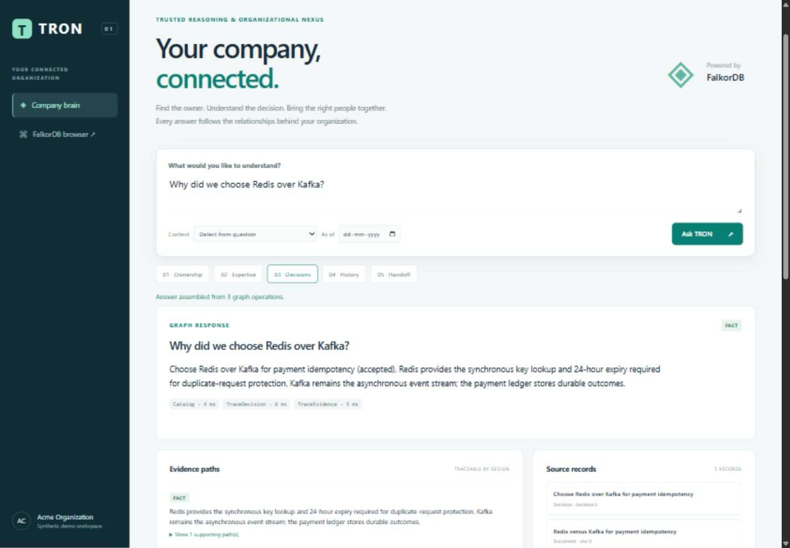
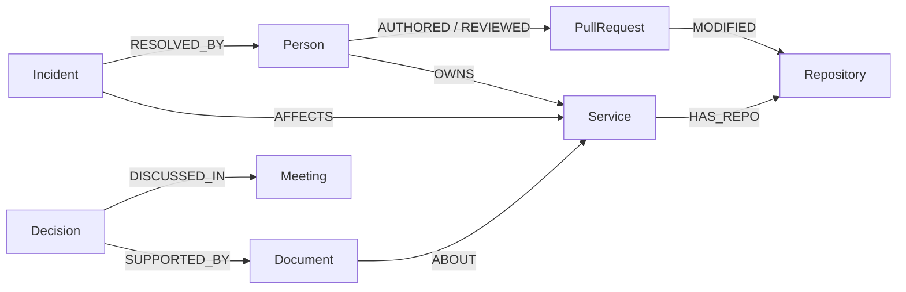

# TRON — Trusted Reasoning & Organizational Nexus

**Graph Hacks 2026 · Track 03: Company Brain**

TRON connects people, teams, services, code contributions, documents, chats, tickets, incidents, and decisions in FalkorDB. Ask who owns a service, who has relevant experience, why a decision was made, or who should investigate an incident. Every supported answer returns graph operations, evidence paths, and inspectable source records.

The default agent uses deterministic routing across five workflows and needs no LLM or API key. An optional local Ollama mode chooses bounded graph retrievals and selects cited relationship facts; the server renders their endpoints and predicates instead of trusting generated prose. It resolves names from the graph, asks for clarification when ambiguous, runs bounded graph operations, and separates facts, computed inferences, and recommendations. Removing FalkorDB removes the facts and relationships needed to answer.

## Start here: judge's guide

| Review | Link |
|---|---|
| See the product | [60-second walkthrough](artifacts/demo/tron-walkthrough.mp4) · [Download video](https://raw.githubusercontent.com/Shashwat-911/tr0n-shashwat/main/artifacts/demo/tron-walkthrough.mp4) |
| Run it locally | [Docker setup](#run-locally-with-docker) — no Go installation or API key needed |
| Understand the graph | [Data model](#graph-data-model-and-queries) · [Cypher query catalog](docs/CYPHER_QUERIES.md) |
| Inspect the evidence | [Verification report](docs/VERIFICATION.md) · [GitHub Actions](https://github.com/Shashwat-911/tr0n-shashwat/actions) |
| Understand contributions | [13-step implementation guide](docs/COMPLETION_STEPS.md) · [AI disclosure](#ai-assistance-and-contribution-history) |

The video is a captioned sequence of screenshots captured from the running app. Complete local setup is provided below; there is no hosted application deployment.



## Latest roadmap work

The optional model path, Markdown snapshot synchronization, reviewed identity aliases,
database constraints, and credential-selected tenant graphs are implemented locally.
See [the operational contract](docs/LOCAL_MODEL_AND_SYNC.md) for commands and boundaries.
The previous walkthrough demonstrates the deterministic workflows. It does not demonstrate
these newer features. A fresh, continuous end-to-end recording of the current build
(including the local-model and synchronization paths) is **not yet captured** —
this environment has no screen recorder, so the old walkthrough is not relabelled;
the exact manual recording step is in
[`artifacts/demo/README.md`](artifacts/demo/README.md) and the shot list is
[`docs/DEMO_SCRIPT.md`](docs/DEMO_SCRIPT.md).

The three-hop latency is measured, not estimated: [`docs/LATENCY_REPORT.md`](docs/LATENCY_REPORT.md)
records a 3-warm-up + 20-run benchmark before and after a change to the local-model
request, with the raw JSON in [`artifacts/benchmarks/`](artifacts/benchmarks). The
measured bottleneck is model generation, not the graph. The expanded grounded-answer
corpus (18 labeled cases, including an adversarial suite) and its rubric are documented
in [`docs/EVALUATION.md`](docs/EVALUATION.md) §2.6 and §6. Model evaluation results and
remaining gates are tracked separately; this is not a claim that the full M1–M7
production roadmap is complete.

## The problem

During an incident or handoff, a team needs more than a document search. Who owns the service now? Who resolved a similar failure? Why was a technology chosen? The answers are spread across ownership records, engineering activity, tickets, chats, and decisions.

TRON connects those records so a person can trace an answer back to the relationships and sources that support it, then download a handoff draft for review.

## Why FalkorDB is essential

FalkorDB is the primary store for organizational entities, source content, and relationships. The Go application executes parameterized Cypher to produce the answers:

- **Ownership:** follow `OWNS` edges valid at the requested time, retaining previous ownership windows.
- **Expertise:** traverse people → PRs → repositories ← services, incident resolvers, and document authorship; compute a ranking from that evidence.
- **Decisions:** follow `SUPPORTED_BY` and `DISCUSSED_IN` to the recorded rationale, ADR, chat, ticket, and meeting.
- **Handoffs:** combine ownership, expertise, and relevant incident history into an unsent draft with sources.

The UI graph displays relationships returned by these queries. Removing FalkorDB removes the records and traversals needed to answer; there is no fallback answer database.

## Try the five workflows

After setup, open the app and click the numbered prompts:

| Prompt | What to look for |
|---|---|
| **01 · Ownership** — Who owns the Payments service? | Ada Mercer in the initial seed, the `OWNS` evidence path, and source provenance. Use an earlier date to inspect ownership history. |
| **02 · Expertise** — Who knows Payments best? | Ranked people, the `INFERENCE` label, `expertise/v1`, and the paths supporting each score. Ownership receives priority. |
| **03 · Decisions** — Why did we choose Redis over Kafka? | The recorded idempotency rationale and supporting ADR, chat, ticket, and meeting records. Click a source to inspect its content. |
| **04 · History** — Has payments-api timed out before? | Prior timeout incidents, dates, and recorded resolvers. |
| **05 · Handoff** — Prepare a handoff for payments-api timeout investigation | A suggested lead, supporting evidence, and **Download handoff draft**. The draft does not assign or message anyone. |

The same workflows support other entities in the synthetic graph. Choose **Context** for follow-ups such as “Who knows it best?”. Ambiguous entity matches ask for clarification; unsupported questions abstain. To use the separate local-model mode, follow [the Ollama setup](docs/LOCAL_MODEL_AND_SYNC.md#local-model); its answer path is bounded and graph-grounded, and its review status is documented in [the evaluation report](docs/EVALUATION.md).

### How to read an answer

| Label | Meaning |
|---|---|
| **FACT** | A recorded graph fact or source statement, with its supporting path. This is not independent verification of the source. |
| **INFERENCE** | A computed result, such as the versioned expertise ranking. |
| **RECOMMENDATION** | A suggested next step, such as an investigation lead, requiring human review. |

Expand **Evidence paths**, inspect **Source records**, and click nodes in **Connected context**. Source observation dates are visible; TRON does not apply a universal staleness threshold. Conflicting ownership blocks selection of a handoff lead.

## Run locally with Docker

Install Docker Desktop (Windows/macOS) or Docker Engine with Compose (Linux), then:

```sh
git clone https://github.com/Shashwat-911/tr0n-shashwat.git
cd tr0n-shashwat
docker compose up -d --wait falkordb
docker compose build app
docker compose run --rm app seed
docker compose up -d app
```

Open **[TRON at localhost:8080](http://127.0.0.1:8080)**. FalkorDB Browser is available at [localhost:3000](http://127.0.0.1:3000). The database image is pinned by digest, has a health check, and persists data in a named volume with append-only logging. `seed` replaces only the `tron` graph; use it only for the disposable synthetic demo.

To verify the running graph:

```sh
docker compose run --rm app demo
```

To stop the app and database while retaining the graph: `docker compose down`. Run `docker compose up -d app` to resume. Do not use `down -v` unless you intend to discard the persisted demo data.

## Run with Go

Go 1.26.5 or newer is required. Start FalkorDB first, then:

```sh
go run ./cmd/tron seed
go run ./cmd/tron serve
```

| Variable | Default | Purpose |
|---|---|---|
| `TRON_FALKOR_ADDR` | `localhost:6379` | FalkorDB address |
| `TRON_HTTP_ADDR` | `127.0.0.1:8080` | HTTP bind address |

The local server and Docker host ports bind to loopback. The default configuration is a single-company local demo. Optional server-owned bearer credentials isolate tenant graphs; see the access contract above. Public hosting and private-source connectors are not included.

## Keep knowledge current

The repository includes two fictional source records with explicit identity mappings. With the Docker app running, import them twice:

```sh
docker compose run --rm -v "./examples:/examples:ro" app import /examples/sources.json
docker compose run --rm -v "./examples:/examples:ro" app import /examples/sources.json
```

The second run reports zero changes. Modify the source body and advance `observed_at` to refresh it; the importer updates the document and replaces its own authorship/topic links in one graph mutation. It rejects missing identities, identity/source collisions, and stale observations. Kinds include `adr`, `runbook`, `spec`, `note`, `chat`, and `ticket`, represented as `Document` artifacts. This is a structured file import, not automatic extraction from arbitrary text. Each record is atomic; if a batch fails, prior completed records remain and a corrected batch can safely be retried.

Record a sourced ownership change while retaining the previous validity window:

```sh
docker compose run --rm app owner-set service:payments-api person:2 synthetic/registry/ownership-change
```

Refresh the ownership answer, then use an earlier date to see the previous owner. Repeating the same owner is a no-op. Run `docker compose run --rm app seed` to restore the initial fictional demo after experimenting. Go users can run the equivalent `go run ./cmd/tron import examples/sources.json` and `go run ./cmd/tron owner-set ...` commands.

## Graph data model and queries

The seed contains **339 nodes across 11 labels** and **958 relationships across 16 types**. All data is fictional. People connect to teams, projects, PRs, documents, and incidents. Services connect to repositories, technologies, owners, and dependencies. Decisions connect to source artifacts, authors, meetings, and superseded decisions.



See [the full graph model](docs/GRAPH_MODEL.md), [query catalog](docs/CYPHER_QUERIES.md), and [executable Cypher](internal/graph/graph.go). Expertise weights and recency decay live in [expertise.go](internal/knowledge/expertise.go). Ownership receives priority; scores are evidence-based ranking signals, not probabilities or validated measures of employee performance.

## How the application works

```text
Browser or HTTP client
        |
Go API -> deterministic question router -> graph operations -> FalkorDB
        |                                      |
        +---- layered answer + source evidence-+

Explicit CLI import / owner-set commands ------> FalkorDB
```

| Component | Responsibility | Code |
|---|---|---|
| Graph | Parameterized Cypher, identity resolution, provenance, historical ownership, bounded evidence context | [internal/graph](internal/graph) |
| Knowledge | Claim contracts and deterministic expertise scoring | [internal/knowledge](internal/knowledge) |
| Agent | Five question intents, clarification, evidence collection, and handoff composition; a separate provider-neutral tool loop | [internal/agent](internal/agent) |
| Interface | HTTP endpoints and embedded HTML/CSS/JavaScript workspace | [internal/api](internal/api) · [internal/ui](internal/ui) |
| Data and commands | Fictional company seed, local server, imports, ownership updates, and demo checks | [internal/seed](internal/seed) · [cmd/tron](cmd/tron) |

The stack is Go + FalkorDB + an embedded browser UI. The optional Ollama adapter is local and needs no hosted API key; deterministic workflows continue to work when Ollama is stopped. The model path is separate from `/v1/ask` and is available at `/v1/grounded`.

## API

`GET /v1/health` checks the graph; `GET /v1/catalog` supplies selectable identities. `POST /v1/ask` accepts:

```json
{"question":"Why did we choose Redis over Kafka?"}
```

Optional fields: `target` (exact key/name) and `as_of` (RFC3339, ownership/expertise only). Responses include `answer`, layered `claims`, `operations_used`, `latency_ms`, `evidence`, `warnings`, optional `candidates`, and an optional `handoff` draft. Unsupported questions abstain. No HTTP endpoint executes a write action.

The seven lower-level read endpoints remain available: `/v1/owner`, `/v1/experts`, `/v1/decision`, `/v1/incidents`, `/v1/evidence`, `/v1/resolve`, and `/v1/conflicts`. See [the operation contracts](docs/AGENT_SPEC.md).

## Verification

```sh
go test ./... -short       # pure checks, no database required
go test ./...              # all checks against real FalkorDB
go vet ./...
go run ./cmd/tron demo     # seven graph checks, nonzero exit on failure
```

Integration tests use dedicated `tron_*_test` graphs and remove them afterwards. New coverage includes question routing and abstention, all five question workflows, source import idempotency/update behavior, ownership changes and historical boundaries, duplicate identity rejection, request validation, and bounded agent calls.

## Scope and limitations

**Implemented:** the five graph-backed workflows, source drill-down, historical ownership, conflict detection, explicit structured source refresh, ownership updates, a caller-scored decision calculator (`tron plan`), local draft actions with process-local replay (`internal/actions`), snapshot risk alerts (`tron alerts`), and downloadable handoff drafts.

**Boundaries of this submission:**

- The default `/v1/ask` flow is deterministic across five intents. Optional local Ollama answers select retrieved relationship facts; they do not provide unrestricted reasoning or free-form factual synthesis.
- All demonstration data is synthetic. Chats and tickets are `Document` records; no live Slack, GitHub, or other private-source connector is enabled.
- Import requires structured records with explicit identities. It does not automatically extract facts from arbitrary prose.
- Historical expertise filters ownership only; other activity scores use recorded activity and current recency. It is not a complete historical expertise snapshot.
- The app requires one writer per graph. Optional bearer credentials select tenant graphs, but per-document ACLs, managed identity, and production access controls are not implemented.
- Source refresh retains the latest document body; ownership updates preserve relationship history. These are different retention guarantees.
- The participant-reviewed Q&A samples are documented in [MODEL_REVIEW.md](docs/MODEL_REVIEW.md). Comparative search/RAG baselines have not been run; the small synthetic model evaluation does not establish broad accuracy.
- Decision planning calculates rankings from caller-supplied scores and labels that input as unverified. Alerts are snapshot graph rules without a measured precision/recall corpus. The action prototype generates local drafts only; its in-memory records are not durable and it has no external execution adapter.

## Submission checklist

| Requirement | Where to review |
|---|---|
| Track | **Track 03 — Company Brain** |
| Public source | [Shashwat-911/tr0n-shashwat](https://github.com/Shashwat-911/tr0n-shashwat) |
| Setup or deployment | [Complete local Docker setup](#run-locally-with-docker) |
| Graph model | [GRAPH_MODEL.md](docs/GRAPH_MODEL.md) |
| Cypher and graph logic | [CYPHER_QUERIES.md](docs/CYPHER_QUERIES.md) · [Executable operations](internal/graph/graph.go) |
| Working-product demonstration | [Captioned walkthrough](artifacts/demo/tron-walkthrough.mp4) · [Direct download](https://raw.githubusercontent.com/Shashwat-911/tr0n-shashwat/main/artifacts/demo/tron-walkthrough.mp4) |
| Verification | [Report](docs/VERIFICATION.md) · [CI](https://github.com/Shashwat-911/tr0n-shashwat/actions) · `docker compose run --rm app demo` |
| Data provenance | Fictional seeded company and synthetic example imports |
| AI disclosure | Below |

For a longer interactive presentation, use the [narrated demo script](docs/DEMO_SCRIPT.md). The broader production roadmap in `docs/` describes future work; it is not a claim that those features are implemented.

## AI assistance and contribution history

Codex assisted with implementation, debugging, tests, UI, and documentation. Participants must review and understand the graph model, queries, scoring, and technical decisions, and disclose their own contribution accurately.

The original team history and subsequent fixes are preserved. The completion work was organized into **13 reviewable feature commits**, documented in [COMPLETION_STEPS.md](docs/COMPLETION_STEPS.md). This README refinement follows those commits. The grouping explains the changes; it does not imply separate development sessions.
