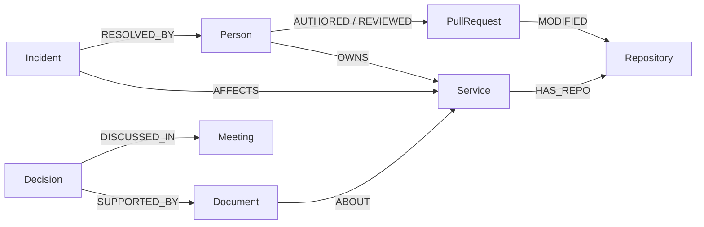

# TRON — Trusted Reasoning & Organizational Nexus

**Graph Hacks 2026 · Track 03: Company Brain**

TRON connects people, teams, services, code contributions, documents, chats, tickets, incidents, and decisions in FalkorDB. Ask who owns a service, who has relevant experience, why a decision was made, or who should investigate an incident. Every supported answer returns graph operations, evidence paths, and inspectable source records.

The agent uses deterministic routing across five workflows. It needs no LLM or API key. It resolves names from the graph, asks for clarification when ambiguous, runs bounded graph operations, and separates facts, computed inferences, and recommendations. Removing FalkorDB removes the facts and relationships needed to answer.

## Start with Docker only

Install Docker Desktop (Windows/macOS) or Docker Engine with Compose (Linux), then:

```sh
git clone https://github.com/Shashwat-911/tr0n-shashwat.git
cd tr0n-shashwat
docker compose up -d --wait falkordb
docker compose build app
docker compose run --rm app seed
docker compose up -d app
```

Open **[TRON at localhost:8080](http://127.0.0.1:8080)**. FalkorDB Browser is available at [localhost:3000](http://127.0.0.1:3000). The database image is pinned by digest, has a health check, and persists data in a named volume with append-only logging. `seed` replaces only the `tron` graph; use it only for the disposable synthetic demo.

To verify the running graph:

```sh
docker compose run --rm app demo
```

To stop the app and database while retaining the graph: `docker compose down`. Run `docker compose up -d app` to resume. Do not use `down -v` unless you intend to discard the persisted demo data.

## Run with Go

Go 1.26.5 or newer is required. Start FalkorDB first, then:

```sh
go run ./cmd/tron seed
go run ./cmd/tron serve
```

| Variable | Default | Purpose |
|---|---|---|
| `TRON_FALKOR_ADDR` | `localhost:6379` | FalkorDB address |
| `TRON_HTTP_ADDR` | `127.0.0.1:8080` | HTTP bind address |

The local server and Docker host ports bind to loopback. This submission is a single-company local demo; it does not include public hosting, authentication, tenant isolation, or private-source integrations.

## The five workflows

| Ask | What FalkorDB does |
|---|---|
| Who owns the Payments service? | Resolves a service and reads valid `OWNS` edges with provenance |
| Who knows Payments best? | Follows PR → repository → service, document authorship, incident resolvers, and ownership; computes `expertise/v1` |
| Why did we choose Redis over Kafka? | Reads recorded rationale and follows supporting ADR, chat, ticket, and meeting records |
| Has payments-api timed out before? | Follows `Incident → AFFECTS → Service` and `RESOLVED_BY`; optional literal timeout filtering |
| Prepare a handoff for payments-api timeout investigation | Combines ownership, ranked expertise, and history into a downloadable, unsent Markdown draft |

Choose a context for follow-ups such as “Who knows it best?”. The optional date queries historical ownership. For expertise it filters **ownership only**; scores use the recorded activity and current recency, not a complete historical snapshot. Ownership conflicts block selection of a handoff lead. Source observation timestamps are displayed for review; there is no universal staleness threshold.

## Keep knowledge current

The repo includes two allowed synthetic source records. Import them with explicit identity mappings:

```sh
go run ./cmd/tron import examples/sources.json
go run ./cmd/tron import examples/sources.json
```

The second run reports zero changes. Modify the source body and advance `observed_at` to refresh it; the importer updates the document and replaces its own authorship/topic links in one graph mutation. It rejects missing identities, identity/source collisions, and stale observations. Kinds include `adr`, `runbook`, `spec`, `note`, `chat`, and `ticket`, represented as `Document` artifacts. This is a structured file import, not automatic extraction from arbitrary text. Each record is atomic; if a batch fails, prior completed records remain and a corrected batch can safely be retried.

Record a sourced ownership change while retaining the previous validity window:

```sh
go run ./cmd/tron owner-set service:payments-api person:2 synthetic/registry/ownership-change
```

Refresh the ownership answer, then use an earlier date to see the previous owner. Repeating the same owner is a no-op. Use `seed` to restore the original fictional demo after experimenting.

## Graph data model and queries

The seed contains **339 nodes across 11 labels** and **958 relationships across 16 types**. All data is fictional. People connect to teams, projects, PRs, documents, and incidents. Services connect to repositories, technologies, owners, and dependencies. Decisions connect to source artifacts, authors, meetings, and superseded decisions.



See [the full graph model](docs/GRAPH_MODEL.md), [query catalog](docs/CYPHER_QUERIES.md), and [executable Cypher](internal/graph/graph.go). Expertise weights and recency decay live in [expertise.go](internal/knowledge/expertise.go). Ownership receives priority; scores are evidence-based ranking signals, not probabilities or validated measures of employee performance.

## API

`GET /v1/health` checks the graph; `GET /v1/catalog` supplies selectable identities. `POST /v1/ask` accepts:

```json
{"question":"Why did we choose Redis over Kafka?"}
```

Optional fields: `target` (exact key/name) and `as_of` (RFC3339, ownership/expertise only). Responses include `answer`, layered `claims`, `operations_used`, `latency_ms`, `evidence`, `warnings`, optional `candidates`, and an optional `handoff` draft. Unsupported questions abstain. No HTTP endpoint executes a write action.

The seven lower-level read endpoints remain available: `/v1/owner`, `/v1/experts`, `/v1/decision`, `/v1/incidents`, `/v1/evidence`, `/v1/resolve`, and `/v1/conflicts`. See [the operation contracts](docs/AGENT_SPEC.md).

## Verification

```sh
go test ./... -short       # pure checks, no database required
go test ./...              # all checks against real FalkorDB
go vet ./...
go run ./cmd/tron demo     # seven graph checks, nonzero exit on failure
```

Integration tests use dedicated `tron_*_test` graphs and remove them afterwards. New coverage includes question routing and abstention, all five question workflows, source import idempotency/update behavior, ownership changes and historical boundaries, duplicate identity rejection, request validation, and bounded agent calls.

## Submission

- **Track:** Track 03 — Company Brain.
- **Source and local setup:** this repository and the commands above.
- **Graph model and queries:** linked above.
- **Demo:** [60-second captioned walkthrough](artifacts/demo/tron-walkthrough.mp4), assembled from screenshots of the running app; [recording script](docs/DEMO_SCRIPT.md) for a narrated live demonstration. [Direct video download](https://raw.githubusercontent.com/Shashwat-911/tr0n-shashwat/main/artifacts/demo/tron-walkthrough.mp4). Review the walkthrough before submitting; a narrated live demo is recommended.
- **AI disclosure:** Codex assisted with implementation, debugging, tests, UI, and documentation. Participants must review and understand the graph model, queries, scoring, and technical decisions, and disclose their own contribution accurately.

The larger production roadmap in `docs/` includes optional future work. This local competition build does not claim general-purpose natural-language reasoning, live Slack/GitHub synchronization, autonomous external actions, or production security.

### Contribution history

The original team history is preserved. The completion work is organized into 13 reviewable commits; see [the change guide](docs/COMPLETION_STEPS.md). These commits organize the completed work by feature, not a claim of separate development sessions.
