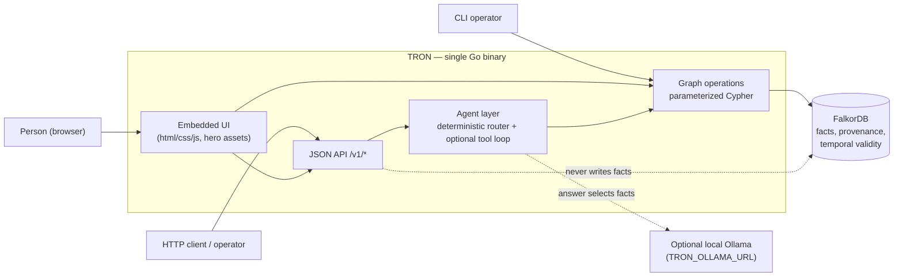
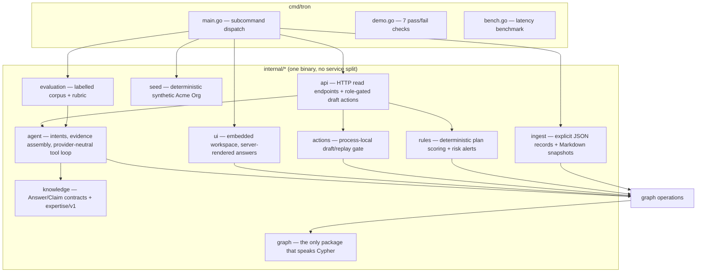
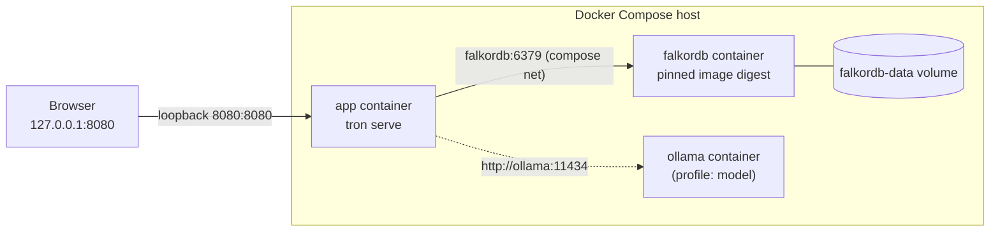
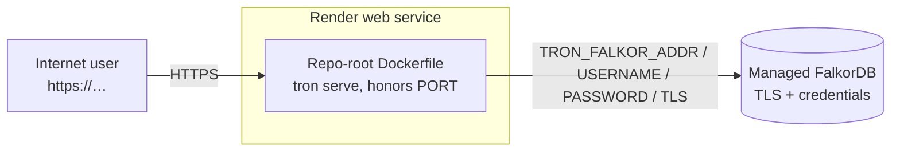
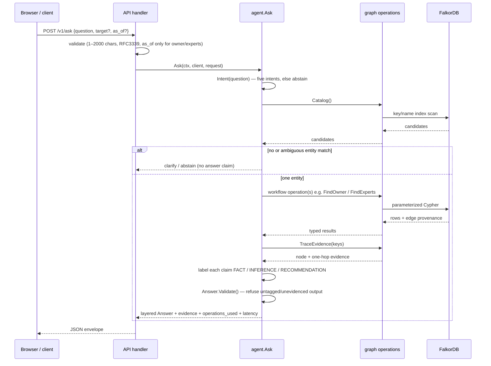

# TRON — Architecture & System Design

**Status**: current-state guide for the implemented system (source of truth: the
code and its tests). Design intent that is not yet built is labelled **PLANNED**
or **PARTIAL** and never described as shipped.

TRON ("Trusted Reasoning & Organizational Nexus") is a graph-native "company
brain": it connects people, teams, services, repositories, pull requests,
documents, meetings, incidents, and decisions in FalkorDB, then answers
ownership, expertise, decision-provenance, incident-history, and handoff
questions with the graph operations and source records that support each answer.
This guide explains how the pieces fit together; it does not restate the root
[README](../README.md) or the locked specifications, which it links instead.

---

## 1. Purpose and scope

**The problem.** During an incident or handoff a team needs more than document
search: who owns this service *now*, who resolved a similar failure, why a
technology was chosen. Those answers live in separate systems — ownership
registries, code hosts, trackers, chat, decision records — and cannot be
recovered by keyword search once the links between them are lost.

**What TRON does.** It materializes those links as a knowledge graph and answers
questions by traversing them. Every supported answer carries its graph
operations, evidence paths, and inspectable source records, and separates
recorded facts from computed inferences and recommendations.

**Graph-native by design.** FalkorDB is not a cache in front of another store;
it *is* the fact store. The Go application runs parameterized Cypher to produce
answers. Removing FalkorDB removes the records and traversals required to
answer, and there is no fallback answer database
([docs/architecture-minimal.md](architecture-minimal.md)).

**Scope of this document.** The architectural shape and the runtime contracts of
the shipped code: processes, packages, the request path, the graph model, the
answer layers, configuration, deployment, security boundaries, and verification.
Product narrative and demo scripting live in [DEMO_SPEC.md](DEMO_SPEC.md) and
[DEMO_SCRIPT.md](DEMO_SCRIPT.md); the full target design is in
[TECHSPEC.md](TECHSPEC.md) and [PRODUCT_SPEC.md](PRODUCT_SPEC.md).

---

## 2. System context

TRON is a **modular monolith**: one Go binary that serves both the embedded
browser UI and a JSON API over a single external dependency, FalkorDB. Users and
clients never talk to FalkorDB directly. An optional local Ollama server powers
a separate, bounded model path.



Key context facts:

- The UI is **server-rendered HTML plus embedded assets**, not a separate
  frontend service; the API is the only programmatic surface.
- The agent layer is optional and sits *beside* the deterministic path. It may
  choose operations and phrase prose; it may not assert facts or write to the
  graph ([knowledge-model.md](knowledge-model.md)).
- FalkorDB is reachable over the Redis protocol; the application is the only
  writer of facts (see §9 and [§12](#12-security-and-trust-boundaries)).

---

## 3. Architecture diagrams

### 3.1 Components and dependencies



`internal/graph` is the only package that contains Cypher; every other layer
consumes typed operation results
([docs/AGENT_SPEC.md](AGENT_SPEC.md), [docs/architecture-minimal.md](architecture-minimal.md)).

### 3.2 Local Docker deployment



The Compose file binds every published port to `127.0.0.1` only, so a local run
is not reachable from the network. The `app` and `model` services are behind
Compose profiles and are started explicitly
([compose.yaml](../compose.yaml), the root [README](../README.md)).

### 3.3 Hosted deployment



A hosted preview is **PARTIAL**: the repository supports it (the server honors
the platform `PORT`, and managed FalkorDB credentials/TLS are implemented), and
the root README records a Render preview at `tr0n.onrender.com` whose
`/v1/health` currently reports `unavailable` while its managed database
connection is resolved. Do not describe the hosted instance as healthy; the
local Docker path is the reproducible demo
([README](../README.md), [LOCAL_MODEL_AND_SYNC.md](LOCAL_MODEL_AND_SYNC.md)).

### 3.4 Question-to-answer request sequence



---

## 4. Component and package responsibilities

Implementation status is labelled per package.

| Package | Responsibility | Status |
|---|---|---|
| [cmd/tron](../cmd/tron/main.go) | Single entrypoint: `serve`, `seed`, `demo`, `owner`, `owner-set`, `import`, `sync`, `identity-link`, `constraints`, `plan`, `alerts`, `bench`, `eval-model` | IMPLEMENTED |
| [internal/graph](../internal/graph/graph.go) | The only Cypher in the codebase: connection, identity resolution, the five operations, evidence assembly, provenance shapes, temporal ownership, load/reset, bounded evidence context | IMPLEMENTED |
| [internal/knowledge](../internal/knowledge/answer.go) | Claim/answer contracts (`FACT`/`INFERENCE`/`RECOMMENDATION`) and the versioned expertise scorer (`expertise/v1`) | IMPLEMENTED |
| [internal/agent](../internal/agent/ask.go) | Five-intent router, clarification/abstention, evidence collection, handoff composition, and a provider-neutral tool loop (`Session` + `Decide`) | IMPLEMENTED |
| [internal/api](../internal/api/api.go) | HTTP read endpoints and role-gated local draft actions; request validation and limits | IMPLEMENTED |
| [internal/ui](../internal/ui/ui.go) | Embedded workspace (HTML/CSS/JS + hero assets); server-rendered built-in answers | IMPLEMENTED |
| [internal/seed](../internal/seed/seed.go) | Deterministic synthetic "Acme Org" graph (339 nodes, 958 edges) | IMPLEMENTED |
| [internal/ingest](../internal/ingest/files.go) | Explicit structured-record import and Markdown-snapshot manifests (no crawling) | IMPLEMENTED |
| [internal/actions](../internal/actions/actions.go) | Deterministic authorization gate and process-local draft/approve/execute replay records (no external or graph mutation) | PARTIAL |
| [internal/rules](../internal/rules/rules.go) | Caller-scored option comparison (`tron plan`) and snapshot risk alerts (`tron alerts`) | PARTIAL |
| [internal/evaluation](../internal/evaluation/model.go) | Labelled corpus and rubric for the optional local model | PARTIAL |
| [frontend](../frontend/README.md) | Vite + React + TypeScript source for the landing hero; builds to embedded `internal/ui/hero-assets` | IMPLEMENTED |
| LLM provider adapters (OpenAI/Anthropic/etc.) | Only the Ollama adapter and the provider-neutral seam exist today | PLANNED |
| Live source connectors (Slack, GitHub, Jira) | Not enabled; imports are explicit and file-based | PLANNED |

The code deliberately does **not** create speculative abstraction layers
(`GraphProvider`, repository/service layers, config frameworks). A package
exists only when real code exists
([docs/architecture-minimal.md](architecture-minimal.md)).

---

## 5. Request lifecycle

For a question sent to `POST /v1/ask`:

1. **Transport and limits.** The server sets `ReadHeaderTimeout` 5s,
   `ReadTimeout` 15s, `WriteTimeout` 180 s, `IdleTimeout` 60 s; request bodies
   are capped at 1 MiB, and unknown JSON fields are rejected.
2. **Input validation.** `question` must be 1–2000 characters, `target` at most
   300; `as_of` must be RFC3339 and is accepted only for ownership and
   expertise intents ([internal/api/api.go](../internal/api/api.go)).
3. **Routing.** `agent.Intent` classifies the question by keyword into one of
   five intents; anything else abstains with a fixed message and no claims.
4. **Entity resolution.** A catalog scan of graph keys/names produces
   candidates. Zero or multiple matches return a clarification request with the
   candidate list; equal scores never auto-select a winner
   ([internal/agent/ask.go](../internal/agent/ask.go)).
5. **Graph retrieval.** The intent selects the workflow operations (Section 6),
   each run as parameterized Cypher inside `internal/graph`.
6. **Evidence assembly.** `TraceEvidence` re-fetches the referenced keys with
   full properties and one hop of context, every edge carrying provenance.
7. **Answer-layer labelling.** Each claim is tagged `FACT`, `INFERENCE`, or
   `RECOMMENDATION`; inferences carry a `rule_id`, recommendations their basis.
8. **Response-type guard.** `knowledge.Answer.Validate` refuses to render an
   untagged or unevidenced claim — the response type is the guard, not reviewer
   vigilance ([internal/knowledge/answer.go](../internal/knowledge/answer.go)).
9. **Rendering.** The JSON API returns the envelope (`answer`, `claims`,
   `operations_used`, `latency_ms`, `evidence`, `warnings`, optional `target`,
   `candidates`, `handoff`); the UI renders the same type.

The optional model path (`POST /v1/grounded`) is separate and bounded; see
Section 6 and [LOCAL_MODEL_AND_SYNC.md](LOCAL_MODEL_AND_SYNC.md).

---

## 6. Core workflows

The deterministic no-key path covers five intents. Each is implemented in
[internal/agent/ask.go](../internal/agent/ask.go) on top of operations in
[internal/graph](../internal/graph/graph.go).

| Workflow | Question shape | Graph operations | Answer layer |
|---|---|---|---|
| **Ownership** | "Who owns payments-api?" | `FindOwner` (time-aware), `TraceEvidence` | FACT |
| **Expertise** | "Who knows payments-api best?" | `FindExperts` (`expertise/v1`), `TraceEvidence` | INFERENCE |
| **Decision provenance** | "Why did we choose Redis over Kafka?" | `TraceDecision` (`SUPPORTED_BY`, `DISCUSSED_IN`, supersedes), `TraceEvidence` | FACT |
| **Incident history** | "Has payments-api timed out before?" | `FindRelatedIncidents`, `TraceEvidence` | FACT |
| **Handoff / routing** | "Prepare a handoff for a payments-api timeout" | `FindOwner` + `FindExperts` + `FindRelatedIncidents`, composed draft | RECOMMENDATION |

Cross-cutting behaviour:

- **Clarification** when an entity match is ambiguous; **abstention** when no
  intent matches or no supporting fact exists.
- **Conflict handling**: multiple valid owners block handoff-lead selection and
  raise a warning rather than choosing silently.
- **Handoff** produces a downloadable Markdown draft with sources and cautions;
  it assigns and messages nobody.
- **Optional local model** (`/v1/grounded`): a bounded tool loop where the model
  selects evidence IDs and the server renders the actual relationship endpoints
  and predicates. Limits: four successful one-hop retrievals, ≤32 facts and
  16 KiB per retrieval, six model decisions, a 150-second deadline, and one
  in-flight question (otherwise `429`). It never receives write tools, arbitrary
  Cypher, filesystem access, or a caller-chosen provider URL.

---

## 7. Knowledge graph design

The graph model is locked in [GRAPH_MODEL.md](GRAPH_MODEL.md); the provenance
and temporal rules are in [knowledge-model.md](knowledge-model.md); the
executable Cypher is in [internal/graph](../internal/graph/graph.go) and
[CYPHER_QUERIES.md](CYPHER_QUERIES.md).

- **Entities (11):** Person, Team, Project, Repository, Service, Document,
  Decision, Meeting, Incident, PullRequest, Technology.
- **Relationships (16 types):** `WORKS_IN`, `OWNS`, `WORKED_ON`, `AUTHORED`,
  `REVIEWED`, `MODIFIED`, `HAS_REPO`, `DEPENDS_ON`, `AFFECTS`, `RESOLVED_BY`,
  `SUPPORTED_BY`, `DISCUSSED_IN`, `PARTICIPATED_IN`, `SUPERSEDES`, `ABOUT`,
  `USES`.
- **Identity:** every node carries `key = "<src>:<native-id>"`; a second source
  for the same entity adds an alias rather than a duplicate node.
- **Provenance on every fact edge:** `src_type`, `src_ref`, `observed_at`,
  `extraction`, and `valid_from`/`valid_to`. The answer's evidence chain *is*
  the audit trace.
- **Temporal validity:** mutating relations (`WORKS_IN`, `OWNS`, `WORKED_ON`,
  `HAS_REPO`, `DEPENDS_ON`) carry half-open validity windows; "current" means
  `valid_to IS NULL` and point-in-time queries use
  `valid_from <= t < valid_to`. Updates close the old edge and open a new one —
  never rewrite — so history is preserved.
- **Exclusivity:** only `OWNS` is single-valued per target per era; conflict
  detection must not assume exclusivity elsewhere.
- **Cypher only in one package.** `internal/graph` owns every query; the API and
  agent call typed operations and never build ad-hoc Cypher.

**Concurrency:** one `graph.Client` guards a single FalkorDB graph handle with a
global mutex because the driver's schema cache is not safe for concurrent
writes; the connection pool underneath is safe. This is a deliberate ceiling
for the single-writer demo ([internal/graph/graph.go](../internal/graph/graph.go)).

---

## 8. FACT / INFERENCE / RECOMMENDATION

The answer layer distinguishes what is *recorded*, what is *computed*, and what
is *advice*. The distinction is enforced by `Answer.Validate`, not by prose
convention ([docs/knowledge-model.md](knowledge-model.md)).

| Layer | Definition | Backing | Example |
|---|---|---|---|
| **FACT** | Graph state extracted from a structured source by a deterministic rule | Source reference (`src_type`, `src_ref`, `observed_at`) | "Ada Mercer owns payments-api" with the `OWNS` path |
| **INFERENCE** | A conclusion computed from facts by a versioned rule; not observed anywhere | `rule_id` + basis paths + weights version | "`expertise/v1` ranks X first (score …)" |
| **RECOMMENDATION** | Advice for a human, derived from facts and inferences under a policy | Inference basis + policy | "Suggested investigation lead: X" |

Rules that the code enforces: no silent promotion between layers; an
INFERENCE claim without a `rule_id` is rejected; an LLM may select operations
and phrase an answer but may never create edges, scores, or facts. The
`expertise/v1` score is a weighted sum of bounded path classes
(ownership priority; PRs authored 1.0, reviewed 0.6, incidents resolved 1.5,
documents authored 0.8) with a 180-day recency half-life; it is a ranking
signal, not a probability or a performance measure.

---

## 9. Ingestion and synchronization

Ingestion is the **only writer** of facts; the API and agent are read-only with
respect to the graph. Two explicit paths exist today, and neither crawls or
guesses:

| Path | Command | Behaviour | Status |
|---|---|---|---|
| Structured records | `tron import <file.json>` | 1–1000 validated records with explicit identities, up to 5 MiB; idempotent per record | IMPLEMENTED |
| Markdown snapshots | `tron sync <manifest.json>` | Declared relative `.md` paths under an explicit root (path-escape checked), explicit author/about keys, ≤100,000 bytes per file; an empty snapshot needs explicit `allow_empty` because it removes managed documents | IMPLEMENTED |
| Sourced ownership change | `tron owner-set <service> <owner> <source>` | Closes the previous `OWNS` window and opens a new one | IMPLEMENTED |
| Live connectors (Slack, GitHub, trackers) | — | Not enabled | PLANNED |

Failure isolation is a design principle: one bad record must not corrupt or
block others ([docs/architecture-minimal.md](architecture-minimal.md),
[docs/LOCAL_MODEL_AND_SYNC.md](LOCAL_MODEL_AND_SYNC.md)).

---

## 10. API and configuration

### Endpoints

All routes are served by the single binary; `/v1/*` is the JSON API and `/` is
the embedded UI ([internal/api/api.go](../internal/api/api.go)).

| Method + path | Purpose | Notes |
|---|---|---|
| `GET /v1/health` | Liveness/readiness | `200 {"status":"ok"}` when the graph answers, else `503 {"status":"unavailable"}` |
| `POST /v1/ask` | Full Q&A envelope | five intents; optional `target`, `as_of` |
| `GET /v1/catalog` | Selectable identities | used by the UI for follow-ups |
| `POST /v1/grounded` | Optional local-model answer | only when `TRON_OLLAMA_URL` is set; bounded, single-flight |
| `GET /v1/model` | Model availability | reports whether the model path is configured |
| `POST /v1/owner`, `/v1/experts`, `/v1/decision`, `/v1/incidents`, `/v1/evidence`, `/v1/resolve`, `/v1/conflicts` | The underlying operations | one route per graph operation |
| `POST /v1/plan` | Caller-scored option comparison | outputs are only as good as the supplied scores |
| `GET /v1/alerts` | Snapshot risk alerts | derived from current graph state |
| `POST /v1/actions/propose` `/approve` `/execute` | Local draft lifecycle | role-gated; records only, no external execution |

`GET /` serves the workspace; `/app.css`, `/app.js`, and `/hero-assets/*` serve
embedded assets. Health behaviour: there is **no retry loop** —
`/v1/health` calls `Ping` and returns `503` whenever FalkorDB does not answer,
and `200` once it does.

### Configuration

Environment variables verified in the code (`cmd/tron/main.go`,
`internal/graph/graph.go`):

| Variable | Default | Purpose |
|---|---|---|
| `TRON_FALKOR_ADDR` | `localhost:6379` | FalkorDB host and port |
| `TRON_FALKOR_USERNAME` | empty | Managed FalkorDB username, when required |
| `TRON_FALKOR_PASSWORD` | empty | Managed FalkorDB password; **secret** |
| `TRON_FALKOR_TLS` | `false` | Enable TLS for managed endpoints |
| `TRON_GRAPH` | `tron` | Graph name (tenant isolation point) |
| `TRON_HTTP_ADDR` | `127.0.0.1:8080` | HTTP bind address; `PORT` is used when this is unset |
| `TRON_OLLAMA_URL` | unset | Enables the optional local-model path |
| `TRON_OLLAMA_MODEL` | `qwen3:4b-instruct` | Model tag for the local path |
| `TRON_AUTH_FILE` | unset | Path to the tenant credential file (enables bearer auth) |
| `PORT` | platform-injected | Bind port when `TRON_HTTP_ADDR` is unset |
| `TRON_EVAL_*` | unset | `eval-model` only; not needed by `serve` |

---

## 11. Deployment topology

### Local (Docker Compose)

- **Database:** `falkordb/falkordb`, pinned by image digest, with a
  `redis-cli ping` healthcheck and `REDIS_ARGS=--appendonly yes`.
- **Application:** built from the repo-root [Dockerfile](../Dockerfile)
  (two-stage: `golang:1.26.5-alpine` build → `alpine:3.23` runtime, non-root
  uid 10001, `CGO_ENABLED=0`, assets embedded, no Node at runtime). Compose
  profiles: `app` and `model`.
- **Optional model:** `ollama/ollama` behind the `model` profile; GPU override in
  [compose.gpu.yaml](../compose.gpu.yaml).
- **Networking:** every published port binds to `127.0.0.1`, so the stack is
  loopback-only by default.
- **Persistence:** append-only logging is on (`REDIS_ARGS=--appendonly yes`) and
  the compose file declares a named volume, intending to retain the graph across
  `down`/`up` (but not `down -v`). Caveat: the pinned image stores Redis data at
  `/var/lib/falkordb/data` (`FALKORDB_DATA_PATH`), while the volume mounts at
  `/data`, so a persistent volume should point at the image's data directory
  ([compose.yaml](../compose.yaml)).
- **Sequence:** start FalkorDB, build `app`, run `seed` once, then `serve`; see
  the root [README](../README.md).

### Hosted (Render + managed FalkorDB) — PARTIAL

- The same repo-root Dockerfile builds the service; `httpListenAddr` selects
  `TRON_HTTP_ADDR`, then `PORT`, then the loopback default, so a platform that
  injects `PORT` works without configuration.
- A managed FalkorDB endpoint is reached with `TRON_FALKOR_ADDR` plus
  `TRON_FALKOR_USERNAME` / `TRON_FALKOR_PASSWORD` / `TRON_FALKOR_TLS`.
- The Dockerfile advertises `EXPOSE 10000`; the process binds whatever the
  platform supplies.
- **Not claimed healthy.** As of 2026-10-18 the Render preview's `/v1/health`
  reports `unavailable` while its managed database connection is resolved; the
  local Docker path is the reproducible demo ([README](../README.md)).

---

## 12. Security and trust boundaries

**Authentication is off by default.** The default Compose stack is a
loopback-only synthetic demo with no authentication. When `TRON_AUTH_FILE` is
set, `api.TenantHandler` loads a server-owned JSON array of credentials
(`{token, graph, actor, role}`), hashes tokens, compares them in constant time,
and selects the graph **before** any catalog, source, or model retrieval, so a
request parameter cannot pick a different tenant
([internal/api/security.go](../internal/api/security.go)).

- **Roles:** `reader`, `requester`, `approver`, `executor`. Every role can read
  its whole tenant graph — there is no per-node ACL. Action endpoints require the
  matching role.
- **Token hygiene:** 32–256 characters, no whitespace, unique per deployment;
  stored in tab-scoped session storage in the UI. Credentials are never printed
  or committed.
- **Graph-write boundary:** ingestion (import/sync/owner-set) is the only writer;
  the API and agent are read-only. Action drafts are process-local records and do
  **not** mutate the graph or any external system.
- **Model boundary:** the model never receives write tools, arbitrary Cypher,
  filesystem access, or a caller-controlled provider URL; retrieved source
  values are treated as data, never instructions.
- **Input validation & limits:** request bodies are capped, unknown JSON fields
  are rejected, and import/sync inputs are validated against explicit limits.
- **Data policy:** all demonstration data is synthetic and fictional; no
  private-source connector is enabled. See [SECURITY.md](SECURITY.md) and
  [SECURITY_AND_DATA.md](SECURITY_AND_DATA.md) (superseded history).

A shared deployment additionally needs TLS, managed secrets, trusted
reverse-proxy settings, retention/backups, and operational review; those are
**PLANNED**, not shipped ([LOCAL_MODEL_AND_SYNC.md](LOCAL_MODEL_AND_SYNC.md)).

---

## 13. Testing and verification

Tests run against a **real FalkorDB**, because the graph's behaviour is the
behaviour under test; there are no mock graph interfaces. Integration tests use
isolated `*_test` graphs and the synthetic seed.

Commands (from the root [README](../README.md) and CI):

```sh
go vet ./...
go test -race -count=1 -p 1 ./...   # CI: real FalkorDB + race detector
go run ./cmd/tron seed              # deterministic 339 nodes / 958 edges
go run ./cmd/tron demo              # 7/7 graph-backed checks
curl -s http://127.0.0.1:8080/v1/health
```

- **CI** ([.github/workflows/ci.yml](../.github/workflows/ci.yml)) runs a
  `verify` job (FalkorDB service container → `go vet` → `go test -race` →
  `seed` → `demo`) and a `frontend` job (Node 22, `npm ci`, build, and a gate
  that fails if committed hero assets differ from the build output).
- **Local caveat:** the race detector needs cgo, which is unavailable on the
  reporter's Windows host; the container/CI job covers it
  ([docs/VERIFICATION.md](VERIFICATION.md)).
- **Latest recorded results:** all 11 packages pass against a live local
  FalkorDB; the local-model reliability run scored 21/21 rubric and 21/21
  citation-valid on the 21-case corpus; the three-hop latency benchmark is
  measured, not estimated ([RELIABILITY_REPORT.md](RELIABILITY_REPORT.md),
  [LATENCY_REPORT.md](LATENCY_REPORT.md)). These are per-run results, not
  standing guarantees.

---

## 14. Architecture decisions and trade-offs

| Decision | Rationale | Trade-off accepted |
|---|---|---|
| **Modular monolith** (one Go binary) | Fewest moving parts; stdlib HTTP; no service boundaries to maintain before they are needed | Scaling is whole-process; no independent deploy of UI vs API |
| **FalkorDB is essential, not swappable** | The product *is* the traversals; abstracting the engine before a second engine exists was explicitly rejected | Tied to one graph engine; the seam is one package (`internal/graph`) |
| **Deterministic core, probabilistic edge** | Graph operations are reproducible and testable without a model | The default path answers only five intents; it abstains elsewhere |
| **Optional, bounded model layer** | A local model can select and phrase, but the server renders actual facts | No free-form synthesis; fewer facts retrieved, stricter limits |
| **Evidence-first answers** | Provenance is part of the answer, not an appendix | Larger payloads and more queries; a single global graph lock |
| **Explicit ingestion only** | Deterministic extraction keeps provenance auditable; no crawling | No automatic connector onboarding in this build |
| **Single writer per graph** | Makes provenance enforcement and contention auditable | Cross-process concurrent writes need external serialization |

Full rationale and the locked principle list are in
[architecture-minimal.md](architecture-minimal.md),
[technology-evaluation.md](technology-evaluation.md), and
[falkordb-analysis.md](falkordb-analysis.md).

---

## 15. Known limitations and future design

Labelled as **PARTIAL** or **PLANNED** — none of these is claimed as shipped:

- **Historic expertise is partial:** the as-of date filters ownership only;
  other activity scores use recorded activity and current recency.
- **No live connectors:** chats and tickets are `Document` records; Slack,
  GitHub, and tracker ingestion are PLANNED.
- **Import is structured, not semantic:** arbitrary prose is not parsed into
  facts; fuzzy/NER extraction is out of scope until it can carry explicit
  confidence.
- **Actions are drafts:** the propose/approve/execute lifecycle records in
  process memory only; external execution, persistence, and replay-across-restart
  are PLANNED.
- **Planning and alerts are caller-scored / snapshot-based:** `tron plan`
  results reflect supplied scores; `tron alerts` has no established
  false-positive baseline.
- **Tenant isolation is coarse:** per-graph, whole-graph read per role; no
  per-node ACL, managed secrets, or production authorization.
- **Hosted deployment is PARTIAL:** `/v1/health` is not yet green on Render.
- **Scale:** a single global graph lock and one graph handle per client are
  deliberate ceilings for the demo, not a production concurrency design.
- **Evaluation is limited:** the model corpus is small and synthetic; keyword,
  text-RAG, and no-graph baselines have not been established.

Remaining scope and gates are tracked in [TRACKER.md](TRACKER.md),
[IMPLEMENTATIONPLAN.md](IMPLEMENTATIONPLAN.md), and
[EVALUATION.md](EVALUATION.md).

---

## 16. Further reading

| Topic | Document |
|---|---|
| Locked current-state architecture and principles | [architecture-minimal.md](architecture-minimal.md) |
| Full target design | [TECHSPEC.md](TECHSPEC.md) · [PRODUCT_SPEC.md](PRODUCT_SPEC.md) |
| Graph schema and relationships | [GRAPH_MODEL.md](GRAPH_MODEL.md) |
| Provenance, layers, temporal rules | [knowledge-model.md](knowledge-model.md) |
| Operation boundary and agent model | [AGENT_SPEC.md](AGENT_SPEC.md) |
| Executable Cypher | [CYPHER_QUERIES.md](CYPHER_QUERIES.md) |
| Reasoning and answer construction | [REASONING.md](REASONING.md) |
| Access, model, and sync contract | [LOCAL_MODEL_AND_SYNC.md](LOCAL_MODEL_AND_SYNC.md) |
| Actions, authorization, autonomy levels | [ACTIONS.md](ACTIONS.md) |
| Security, privacy, reliability | [SECURITY.md](SECURITY.md) |
| Evaluation and quality gates | [EVALUATION.md](EVALUATION.md) |
| Verification log | [VERIFICATION.md](VERIFICATION.md) · [RELIABILITY_REPORT.md](RELIABILITY_REPORT.md) · [LATENCY_REPORT.md](LATENCY_REPORT.md) |
| Demo narrative and script | [DEMO_SPEC.md](DEMO_SPEC.md) · [DEMO_SCRIPT.md](DEMO_SCRIPT.md) |
| Implementation history | [COMPLETION_STEPS.md](COMPLETION_STEPS.md) · [TRACKER.md](TRACKER.md) |
| Build and run instructions | [README](../README.md) |
