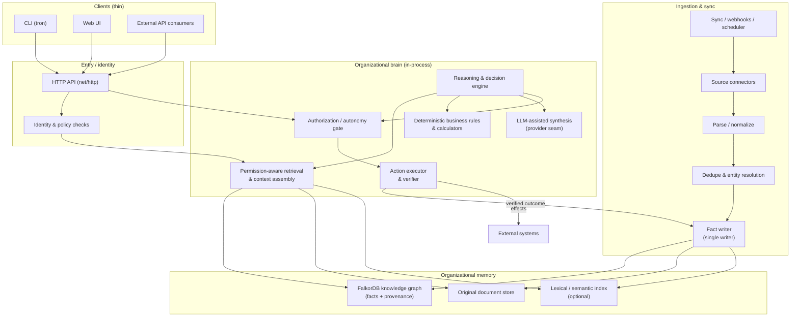
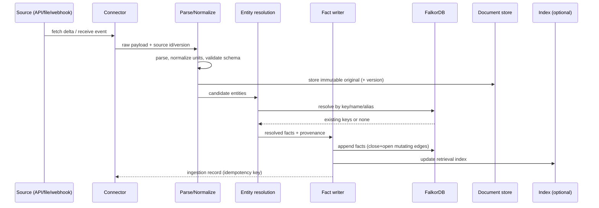
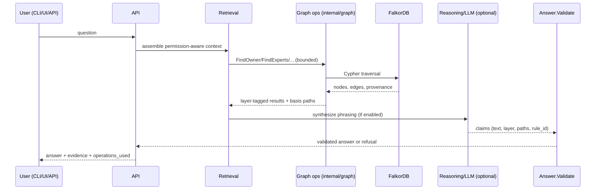
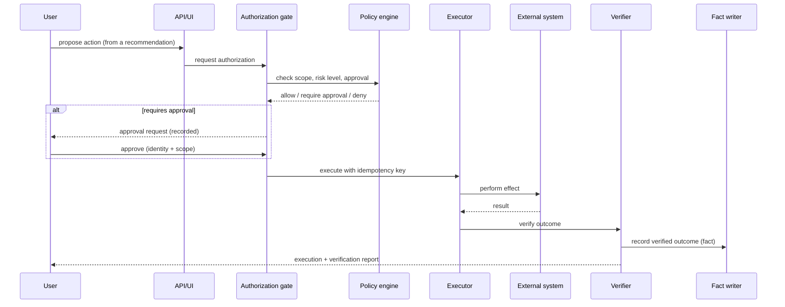

# TRON — Technical Specification (Whole-System Architecture)

**Status**: Canonical. Authority for the **target** system architecture.
**Last updated**: 2026-10-15.
**Current-implementation authority**: [`architecture-minimal.md`](architecture-minimal.md)
(locked). This document describes where the system is going and marks every
component **IMPLEMENTED** / **PARTIAL** / **PROPOSED**. Where they differ,
`architecture-minimal.md` wins for what exists *today*; this document wins
for what TRON is *designed to become*.
**Related**: [`PRD.md`](PRD.md), [`SCHEMA.md`](SCHEMA.md),
[`INGESTION.md`](INGESTION.md), [`REASONING.md`](REASONING.md),
[`ACTIONS.md`](ACTIONS.md), [`SECURITY.md`](SECURITY.md),
[`RULES.md`](RULES.md).

---

## 1. Architectural stance

**Modular monolith.** One static Go binary, one process, in-process package
boundaries, one FalkorDB instance. Rationale (recorded in
`planning/decision-log.md` and `architecture-minimal.md`):

- The workload is network- and graph-bound, not compute-bound; a service mesh
  buys nothing at this scale.
- One deployable keeps provenance enforcement auditable: ingestion is the
  **only** fact writer; API/reasoning/agents are readers.
- Package boundaries are the seams. Split into services only when a measured
  bottleneck or an independent scaling requirement demands it. Until then,
  adding services is speculative complexity (`AGENTS.md` rung 1).

**Determinism where truth matters.** Facts, traversals, scoring, policy
checks, and action authorization are deterministic. LLMs may select tools and
phrase answers; they never create facts, scores, permissions, or approvals
(`knowledge-model.md` invariants 1–3).

## 2. Component map

Legend: every node's implementation status is enumerated in §3. The
**only** arrows that write to memory are the `Fact writer` (`internal/ingest`
— PROPOSED) and the verified-outcome feedback from the executor (PROPOSED).

## 3. Component responsibilities, boundaries, and status

| Component | Package (current name / proposed) | Responsibility | Status |
|---|---|---|---|
| CLI | `cmd/tron` | seed/demo/serve, import/sync, ownership and identity updates, constraints, model evaluation | **IMPLEMENTED** (partial surface) |
| HTTP API | `internal/api` | Health, catalog, deterministic ask, bounded grounded ask, model status, and seven graph operations | **IMPLEMENTED** |
| Web UI | `internal/ui` | Five deterministic prompts plus optional local-model question input and evidence panels | **IMPLEMENTED** |
| Graph client & ops | `internal/graph` | Cypher, traversal, provenance; all Cypher lives here | **IMPLEMENTED** |
| Knowledge types | `internal/knowledge` | Layers, provenance, claim validation | **IMPLEMENTED** |
| Seed | `internal/seed` | Deterministic synthetic graph | **IMPLEMENTED** (demo data only) |
| Agent loop | `internal/agent` | Bounded tool loop with deterministic and local Ollama paths | **PARTIAL** (Ollama selection/citations; semantic quality gate pending) |
| Identity / policy | `internal/api/security.go` | Server-owned bearer token to tenant graph selection | **PARTIAL** (no per-document ACL or managed identity) |
| Source connectors | `internal/ingest`, `internal/graph/sync.go` | Explicit structured imports and Markdown snapshots | **PARTIAL** (no live service connectors) |
| Parse / normalize | `internal/ingest` | Validate structured source records and explicit mappings | **PARTIAL** (no arbitrary prose extraction) |
| Dedupe / entity resolution | `internal/graph` | Canonical identity, reviewed aliases, duplicate-key guards | **PARTIAL** (no cross-source merge) |
| Fact writer | `internal/graph` | Seed, explicit imports/snapshots, sourced ownership updates | **PARTIAL** (single-writer contract; no distributed writer coordination) |
| Document store | FalkorDB `Document` nodes | Latest imported source body plus provenance | **PARTIAL** (not a versioned document archive) |
| Retrieval index | *(none)* | Lexical/semantic scoring to complement graph | **PROPOSED** (optional) |
| Permission-aware retrieval | *(none)* | Filter context by source permissions | **PROPOSED** |
| Reasoning engine | `internal/reason` | Observe→…→Learn pipeline (`REASONING.md`) | **PROPOSED** |
| Deterministic rules | `internal/rules` | Budget/deadline/risk calculators | **PROPOSED** |
| LLM-assisted retrieval | `internal/agent/ollama.go` | Local model chooses bounded retrievals and cited relationship facts | **PARTIAL** (no hosted provider or free-form fact synthesis) |
| Authorization gate | `internal/actions` | Autonomy levels, policy checks | **PROPOSED** |
| Action executor + verifier | `internal/actions` | Idempotent execution, outcome verification | **PROPOSED** |
| Scheduler / sync | `internal/graph/sync.go` | Explicit complete Markdown snapshot synchronization | **PARTIAL** (manual invocation; no scheduler/webhooks) |
| Observability | API/UI and `slog` | Health, answer latency, local model token/call usage, warnings, server logs | **PARTIAL** (no metrics backend or tracing) |

## 4. Interfaces and boundaries

- **Client↔API**: HTTPS/JSON, one API, versioned under `/v1`
  (`internal/api/api.go`). Clients stay thin; no business logic in clients
  (`architecture-minimal.md`).
- **API↔graph**: the deterministic operations only
  (`internal/graph/graph.go`, contracts in `AGENT_SPEC.md`). No ad-hoc Cypher
  outside `internal/graph`. `FindConflicts` → `POST /v1/conflicts` follows the
  same route (contract in `AGENT_SPEC.md`, boundary record in
  `planning/decision-log.md`, `RULES.md` §3.2 A11) — **implemented 2026-10-16**,
  E6 v1; reads state relations only.
- **Business-logic↔reasoning**: deterministic calculators and policy checks
  are called by the reasoning engine; the LLM never computes them.
- **Reasoning↔actions**: a recommendation becomes an action only through the
  authorization gate (`ACTIONS.md`); the LLM cannot grant permission.
- **Ingestion↔graph**: `internal/ingest` is the only fact writer; it must not
  be reachable from request handlers.

## 5. Sequence diagrams

### 5.1 Ingestion (PROPOSED)

Failure handling, retries, and deletion propagation are specified in
[`INGESTION.md`](INGESTION.md).

### 5.2 Answering a question (CURRENT core + PROPOSED reasoning)

Today this is implemented **without** `Z` (deterministic composers in
`internal/ui/ui.go`); `Answer.Validate` (`internal/knowledge/answer.go`)
is the enforcement point and already runs in the UI path.

### 5.3 Executing an approved action (PROPOSED)

Full autonomy levels, idempotency, and audit requirements are in
[`ACTIONS.md`](ACTIONS.md).

## 6. Cross-cutting concerns

| Concern | Where specified | Current state |
|---|---|---|
| Provenance & temporal validity | `knowledge-model.md`, [`SCHEMA.md`](SCHEMA.md) | IMPLEMENTED on edges/nodes; as-of reads implemented (E5, `FindOwner`/`FindExperts` + `/v1/owner`/`/v1/experts`) |
| Layered claims (no silent promotion) | `knowledge-model.md`, `internal/knowledge/answer.go` | IMPLEMENTED |
| Permissions & tenant isolation | [`SECURITY.md`](SECURITY.md) | PROPOSED (loopback only today) |
| Observability | [`EVALUATION.md`](EVALUATION.md) | PARTIAL |
| Evaluation harness | [`EVALUATION.md`](EVALUATION.md) | PROPOSED |
| Determinism guardrails | `AGENTS.md`, [`RULES.md`](RULES.md) | IMPLEMENTED for expertise/ops |

## 7. Failure modes and dependencies

| Failure | Effect | Handling |
|---|---|---|
| FalkorDB unreachable | All ops fail | Health endpoint reports 503; CLI prints seed hint (`cmd/tron/demo.go`) |
| One source corrupts during ingest | Facts from that source polluted | Per-source isolation, ingest as a transaction/undo unit ([`INGESTION.md`](INGESTION.md)) |
| Identity collision | Wrong person linked to a fact | Never guess; candidate list (`internal/graph` ResolveEntity) |
| LLM hallucination | Ungrounded claim | Claim must cite paths/rule_id; `Validate` refuses (IMPLEMENTED) |
| Optimizer exploits model error | Bad plan | Bound search to trained range; uncertainty surface ([`REASONING.md`](REASONING.md)) |
| Action fails mid-flight | Partial external state | Idempotency key + verify + compensating action ([`ACTIONS.md`](ACTIONS.md)) |
| Prompt injection via ingested content | Unauthorized instruction execution | Untrusted-data rule ([`SECURITY.md`](SECURITY.md), [`ACTIONS.md`](ACTIONS.md)) |

## 8. What must NOT change without an ADR

- Single-writer fact boundary (`ARCH-2` in [`RULES.md`](RULES.md)).
- All Cypher confined to `internal/graph`.
- Deterministic core runs without LLM or UI.
- Provenance minimum on every fact.
- Layered claims, no silent promotion.

New technology choices (search index, message queue, service split, LLM
provider) require a decision-log entry per [`RULES.md`](RULES.md) §ADR.
